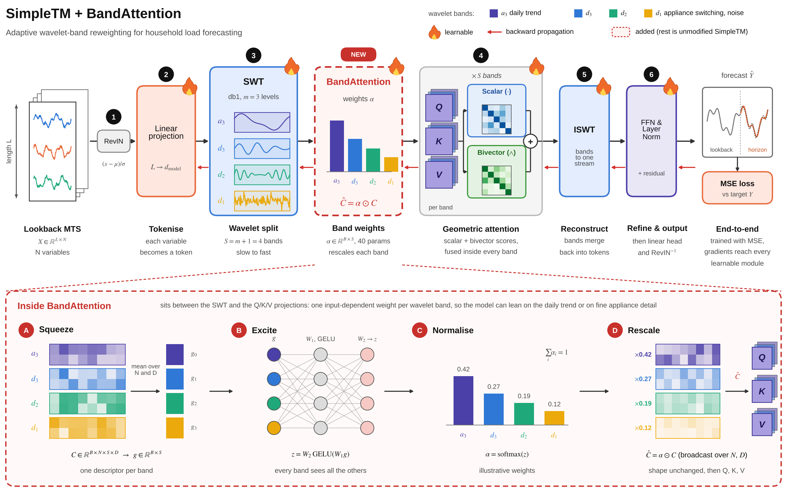

# SimpleTM + Band Attention

Adaptive wavelet-band reweighting for household electricity load forecasting.

This repository adds **Band Attention**, a very small module, to [SimpleTM](https://github.com/vsingh-group/SimpleTM) (ICLR 2025) [6] and tests it on the [SHEERM](https://zenodo.org/records/13619621) household load data [14] and on ECL.

## Table of contents

- [Background](#background)
- [What Band Attention does](#what-band-attention-does)
- [Overall pipeline](#overall-pipeline)
- [Overview diagram](#overview-diagram)
- [Datasets](#datasets)
- [Getting started](#getting-started)
- [Repository structure](#repository-structure)
- [Results](#results)
- [References](#references)
- [Acknowledgement](#acknowledgement)
- [Citation](#citation)

## Background

SimpleTM is a compact forecasting model. It does not look at the raw series directly. Instead it uses a **stationary wavelet transform (SWT)** [7] to split the series into a few **frequency bands**: one slow, smooth trend band plus several detail bands that capture faster and faster changes. Attention is then run over these bands, and an inverse wavelet transform puts the result back into a normal time series.

A single household's load is a smooth daily rhythm with sudden bursts on top (an oven, a kettle, a washing machine). Different bands carry different amounts of useful signal, but SimpleTM treats every band as equally important.

## Overall Pipeline Diagram


## Overall Modified Pipeline

- **Input:** a multivariate series (the household load plus related channels) with a lookback window of 96 steps.
- **Normalise:** the series is normalised per window (RevIN) [12] so the model is not thrown off by changes in scale.
- **Embed:** a linear layer projects each variable's series into a token (the "inverted" layout used by SimpleTM, where each variable is a token).
- **Split into bands:** the stationary wavelet transform (db1, 3 detail levels, filters initialised with PyWavelets [13]) splits every token into 4 frequency bands.
- **Band Attention (new):** the bands are squeezed, scored and re-weighted, so useful bands get more weight and less useful ones get less.
- **Geometric attention:** SimpleTM's geometric-product attention [8] mixes information across tokens within each band.
- **Rebuild:** the inverse wavelet transform joins the bands back into one series.
- **Feed-forward and output:** a feed-forward block with layer norm, then a projection to the forecast horizon, then the normalisation is undone.
- **Train:** the model is trained with MSE loss and evaluated with MSE and MAE (plus R², explained variance, median absolute error and SMAPE).

## Band Attention Detailed Pipeline

Band Attention lets the model **decide how much each band matters for the series it is looking at**, in three small steps:

1. **Squeeze** (as in squeeze-and-excitation [11]): average each band over its tokens and channels, giving one number per band.
2. **Excite:** pass those numbers through a tiny two-layer network (bottleneck size 4) to get a score per band.
3. **Normalise and rescale:** a softmax turns the scores into weights that sum to 1, and each band is multiplied by its weight *before* attention.

The cost is tiny: **40 extra parameters per layer**, and the extra compute is a negligible fraction of the attention cost. The module does not change the rest of the model.

## Datasets

| Dataset | Use | Notes |
|---|---|---|
| **SHEERM, Load House 2** | Main experiments | Household electricity load |
| **SHEERM, Load House 3** | Secondary | Household electricity load |
| **ECL (Electricity)** | Secondary | 321 clients |

Setup used in the paper: lookback **96**, multivariate-to-univariate forecasting, horizons **4, 32, 48, 96, 192 steps** (1, 8, 12, 24, 48 hours), 70% / 10% / 20% train / validation / test split.

## Getting started

**1. Clone the repository**

```bash
git clone https://github.com/malladinagarjuna2/SIMPLETM.git
cd SIMPLETM
```

**2. Switch to the Band Attention branch**

The Band Attention code for testing lives on its own branch, so switch to it before running anything:

```bash
git branch -a                      # list available branches
git checkout changes         # switch to the Band Attention branch
```

**3. Create the environment**

```bash
conda env create -f environment.yml
conda activate SimpleTM
```

**4. Download the data**

- SHEERM: download from [Zenodo](https://zenodo.org/records/13619621) and place the files in `./dataset/`.
- ECL: download it as described in the original SimpleTM repository and place it in `./dataset/` as well.

**5. Train and test**

Run one of the scripts in `./scripts/`, for example:

```bash
bash ./scripts/multivariate_forecasting/<dataset_name>/<script_name>.sh
```

**Training settings used:** learning rate 0.001 (0.006 for ECL), one-cycle schedule, batch size 256, early stopping on validation loss, one layer, Band Attention bottleneck 4. A single GPU (Tesla T4) is enough.

## Results

Results are kept out of this file to keep it short. See **[RESULTS.md](RESULTS.md)** for the tables and an honest discussion of where Band Attention helps and where it does not.

## References

1. H. Zhou et al., "Informer: Beyond efficient transformer for long sequence time-series forecasting," in *Proc. AAAI*, vol. 35, 2021, pp. 11106-11115.
2. H. Wu, J. Xu, J. Wang, and M. Long, "Autoformer: Decomposition transformers with auto-correlation for long-term series forecasting," in *Proc. NeurIPS*, vol. 34, 2021.
3. T. Zhou et al., "FEDformer: Frequency enhanced decomposed transformer for long-term series forecasting," in *Proc. ICML*, 2022, pp. 27268-27286.
4. Y. Nie, N. H. Nguyen, P. Sinthong, and J. Kalagnanam, "A time series is worth 64 words: Long-term forecasting with transformers," in *Proc. ICLR*, 2023.
5. Y. Liu et al., "iTransformer: Inverted transformers are effective for time series forecasting," in *Proc. ICLR*, 2024.
6. H. Chen, V. Luong, L. Mukherjee, and V. Singh, "SimpleTM: A simple baseline for multivariate time series forecasting," in *Proc. ICLR*, 2025.
7. G. P. Nason and B. W. Silverman, "The stationary wavelet transform and some statistical applications," in *Wavelets and Statistics*, Lecture Notes in Statistics, vol. 103, Springer, 1995, pp. 281-299.
8. E. Artin, *Geometric Algebra*, Wiley, 2011.
9. Y. Zhang and J. Yan, "Crossformer: Transformer utilizing cross-dimension dependency for multivariate time series forecasting," in *Proc. ICLR*, 2023.
10. G. Michau, G. Frusque, and O. Fink, "Fully learnable deep wavelet transform for unsupervised monitoring of high-frequency time series," *Proc. Natl. Acad. Sci.*, vol. 119, no. 8, e2106598119, 2022.
11. J. Hu, L. Shen, and G. Sun, "Squeeze-and-excitation networks," in *Proc. IEEE CVPR*, 2018, pp. 7132-7141.
12. T. Kim et al., "Reversible instance normalization for accurate time-series forecasting against distribution shift," in *Proc. ICLR*, 2022.
13. G. R. Lee, R. Gommers, F. Waselewski, K. Wohlfahrt, and A. O'Leary, "PyWavelets: A Python package for wavelet analysis," *J. Open Source Softw.*, vol. 4, no. 36, p. 1237, 2019.
14. "SHEERM dataset: Household electricity consumption records," Zenodo, 2024. https://zenodo.org/records/13619621

## Acknowledgement

This work builds on [SimpleTM](https://github.com/vsingh-group/SimpleTM) (ICLR 2025) and the [Time-Series-Library](https://github.com/thuml/Time-Series-Library). Thanks to the authors for sharing their code. Numbers in square brackets refer to the [References](#references).

## Citation

If you use this code or find it helpful, please cite our paper:

```bibtex
@misc{deolankar2026bandattention,
  title  = {Adaptive Wavelet-Band Reweighting for Household Load Consumption Forecasting},
  author = {Deolankar, Shivam and Nagarjuna, Malladi and Baranwal, Prasun and Sharma, Anshul},
  year   = {2026},
  note   = {Manuscript. Code: https://github.com/malladinagarjuna2/SIMPLETM}
}
```

Please also cite SimpleTM, the backbone this work builds on:

```bibtex
@inproceedings{chen2025simpletm,
  title     = {SimpleTM: A Simple Baseline for Multivariate Time Series Forecasting},
  author    = {Chen, Hui and Luong, Viet and Mukherjee, Lopamudra and Singh, Vikas},
  booktitle = {Proc. Int. Conf. Learning Representations (ICLR)},
  year      = {2025}
}
```